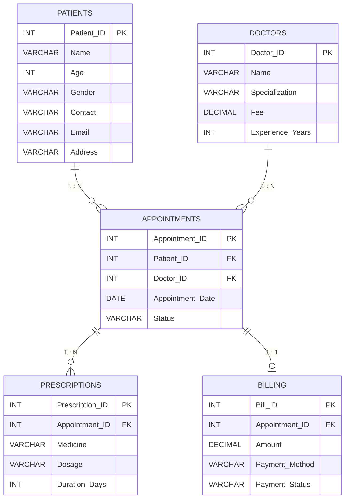

# MediTrack — Hospital Patient Management System

A MySQL database project for managing core hospital workflows, including patient records, doctors, appointments, prescriptions, and billing.

## Project Overview

**Database name:** `MediTrack`  
**DBMS:** MySQL  
**Project type:** SQL / Relational Database Management System (RDBMS)

MediTrack organizes hospital data into related tables to support appointment scheduling, prescription records, billing, and reporting. Primary and foreign keys connect the tables and help maintain referential integrity.

## Entity Relationship Diagram (ERD)

The ER diagram below is written in Mermaid, which GitHub can render directly in a Markdown README.



### Relationships

- **Patients → Appointments (1:M):** A patient can book multiple appointments; each appointment references one patient.
- **Doctors → Appointments (1:M):** A doctor can attend multiple appointments; each appointment references one doctor.
- **Appointments → Prescriptions (1:M):** An appointment can have multiple prescription records; each prescription belongs to one appointment.
- **Appointments → Billing (1:1, optional billing record):** The ERD uses `APPOINTMENTS ||--o| BILLING`, meaning an appointment may have zero or one billing record, while each billing record belongs to exactly one appointment. To prevent multiple bills for the same appointment in MySQL, `Billing.Appointment_ID` should have a `UNIQUE` constraint; a foreign key alone does not enforce one-to-one cardinality.

## Database Schema

| Table | Purpose | Primary Key | Foreign Keys |
|---|---|---|---|
| `Patients` | Stores patient details | `Patient_ID` | — |
| `Doctors` | Stores doctor details and consultation fees | `Doctor_ID` | — |
| `Appointments` | Connects patients and doctors to appointment dates and statuses | `Appointment_ID` | `Patient_ID`, `Doctor_ID` |
| `Prescriptions` | Stores medicines prescribed during appointments | `Prescription_ID` | `Appointment_ID` |
| `Billing` | Stores appointment bills and payment details | `Bill_ID` | `Appointment_ID` |

## Features Demonstrated

- Creating a database and relational tables
- Defining primary keys and foreign keys
- Inserting and retrieving sample records
- Filtering and sorting records with `WHERE` and `ORDER BY`
- Joining related tables
- Aggregations using `COUNT`, `SUM`, and `AVG`
- Grouping results with `GROUP BY` and filtering groups with `HAVING`
- Subqueries and window functions
- Creating indexes, including a unique index on patient email
- Creating views for high-value bills and revenue summaries

## Getting Started

### Requirements

- MySQL Server
- A MySQL client, such as the MySQL command-line client or MySQL Workbench

### Setup

1. Clone or download this repository.
2. Open your MySQL client.
3. Run the schema/setup SQL file to create the `MediTrack` database, tables, and sample records.
4. Run the query file to try the example questions and reports.

If the SQL files are named as described in the project report, the commands will look like this:

```bash
mysql -u your_username -p < meditrack_schema.sql
mysql -u your_username -p MediTrack < meditrack_queries.sql
```

Replace `your_username` with your MySQL username. These commands assume the two `.sql` files are present in the repository root.

## Example Questions Answered

The project includes SQL examples to:

- List appointments after a selected date
- Find payments made by credit card or UPI
- Show doctors with the highest consultation fees
- Retrieve medicines prescribed to a patient
- Find bills above the average billing amount
- Count appointments per patient
- Calculate cumulative billing revenue by date
- Summarize revenue by payment method and doctor specialization
- Identify doctors who have not attended appointments
- Create indexes and reporting views

## Suggested Repository Structure

```text
.
├── README.md
├── meditrack_schema.sql
└── meditrack_queries.sql
```

Add the two SQL files to the repository if you want the project to be runnable from a fresh MySQL installation. The README documents the filenames referenced in the project report.

## Concepts Covered

- Relational database design
- Primary and foreign keys
- One-to-many and one-to-one relationships
- Normalization
- SQL joins, subqueries, aggregate functions, and window functions
- Indexes and views

## References

- [W3Schools SQL Tutorial](https://www.w3schools.com/sql/)
- [SQLBolt](https://sqlbolt.com/)
- [MySQL Documentation](https://dev.mysql.com/doc/)

---

*Educational SQL project: Hospital Patient Management System (MediTrack).*

